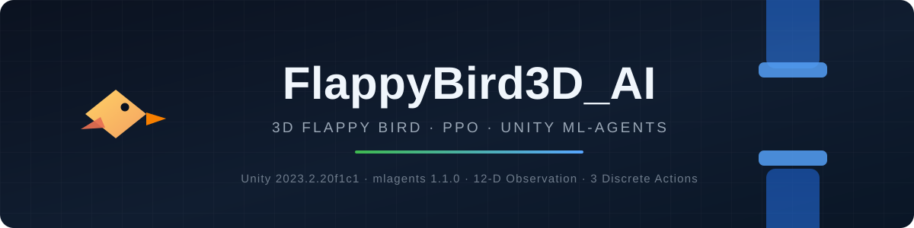
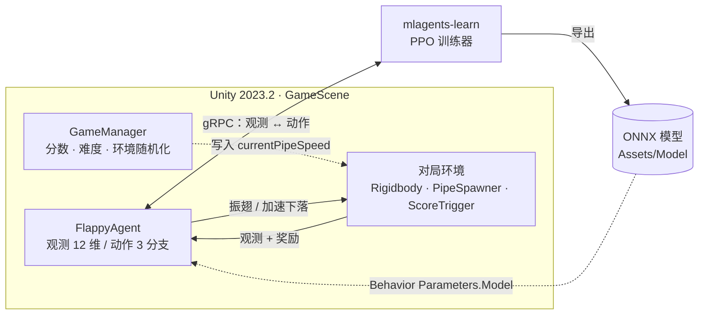
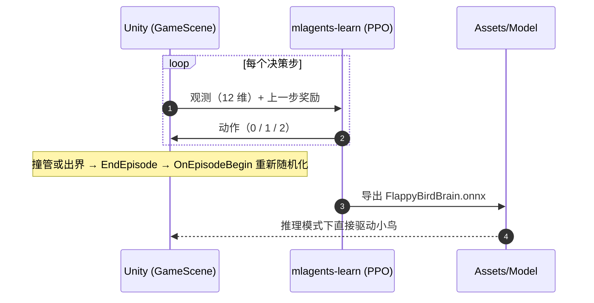

<div align="center">



# FlappyBird3D_AI

**把 Flappy Bird 做成 3D，再用强化学习教会一只小鸟自己飞。**

[](https://unity.com/)
[](https://github.com/Unity-Technologies/ml-agents)
[](docs/training.md)
[](LICENSE)
[](CONTRIBUTING.md)

</div>

---

游戏本体是场景搭建与物理，真正的难点在 AI：**管道速度、生成间隔、上下位置、可见缝隙、小鸟的出生位置与初速度，每一项都在每个回合重新随机**。智能体不能靠背板通关，只能在连续变化的环境里学出一套通用的过管策略。

> 项目目标不是做一个"能跑一次"的演示，而是一个**可复现、可训练、可继续扩展**的强化学习环境：训练配置与代码一起入库，模型与推理路径清晰可查。

## 一眼看懂

| 维度 | 设计 |
| --- | --- |
| 引擎 / 依赖 | Unity `2023.2.20f1c1` · ML-Agents `3.0.0` · Sentis `2.1.0`（推理） |
| 场景 | `MainMenuScene`（模式、音量）→ `GameScene`（对局） |
| 智能体 | `FlappyAgent`：12 维向量观测，3 个离散动作分支 |
| 动作 | `0` 不动作 · `1` 振翅 · `2` 加速下落 |
| 奖励 | 存活 `+0.15`/决策 · 过管 `+0.20` · 撞管 `-1.0` · 出界 `-2.0` |
| 环境随机化 | 管道速度、生成间隔、生成高度、可见缝隙、小鸟出生位置与初速度 |
| 训练算法 | PPO · `batch_size 1024` · `buffer_size 20480` · `time_horizon 256` · 上限 1500 万步 |
| 已训练模型 | `Assets/Model/` 下 3 个 ONNX（约 75–80 KB，可直接推理） |

## 系统结构



## 训练闭环



## 快速开始

```bash
# 1) 克隆
git clone https://github.com/424635328/FlappyBird3D_AI.git
cd FlappyBird3D_AI
```

**看 AI 玩**：用 Unity Hub 以 `2023.2.20f1c1` 打开工程 → 打开 `Assets/Scenes/MainMenuScene.unity` → 点击 Play → 在菜单里选择 **AI 模式**。

> 首次打开时 Unity 会解析 UPM 依赖并重建 `Library/`，需要几分钟；`Library/`、`Temp/` 等目录按 `.gitignore` 不入库，属正常现象。

**跑训练**：

```bash
# 2) 建立 Python 环境（mlagents 1.1.0 要求 Python 3.10.1 – 3.10.12）
python -m venv .venv
.venv\Scripts\activate            # Windows
# source .venv/bin/activate       # macOS / Linux
pip install "mlagents==1.1.0"
python scripts/check_env.py       # 检查 Python / mlagents / PyTorch / CUDA

# 3) 启动训练，然后回到 Unity 按 Play
mlagents-learn config/flappybird_config.yaml --run-id=FlappyBird_Base --force
```

训练监控、断点续训、headless 多环境、模型导出，见 **[docs/training.md](docs/training.md)**。

## 强化学习设计

### 观测 · 12 维

| 序号 | 内容 | 说明 |
| --- | --- | --- |
| 1 | 竖直速度 | `rb.velocity.y` |
| 2 | 竖直位置 | 本地坐标系下的 `y` |
| 3–11 | 前方 3 组管道 × 3 个量 | 缝隙中心相对高度、水平距离、可见缝隙高度 |
| 12 | 当前管道速度 | 由 `GameManager.currentPipeSpeed` 提供 |

管道不足 3 组时用默认值填充；死亡或引用缺失时返回同维度的安全观测，保证向量长度恒定。

### 动作 · 3 个离散分支

| 值 | 行为 |
| --- | --- |
| `0` | 不动作，交给重力 |
| `1` | 清零竖直速度后施加向上冲量 |
| `2` | 在 `FixedUpdate` 中持续施加向下加速度（加速下落） |

### 奖励

| 事件 | 值 | 触发位置 |
| --- | --- | --- |
| 存活一个决策步 | `+0.15` | `OnActionReceived` |
| 穿过一组管道 | `+0.20` | `OnTriggerEnter`（`ScoreTrigger`） |
| 撞到管道 | `-1.0` | `OnCollisionEnter`（`Obstacle`） |
| 飞出上下边界 | `-2.0` | `Update` 边界检查 |

训练参数可读地集中在 `Assets/Scripts/FlappyAgent.cs` 顶部的 `[Header("奖励信号")]` 分组中。

### 环境随机化

| 维度 | 实现位置 | 范围来源 |
| --- | --- | --- |
| 管道移动速度 | `GameManager.RandomizeEnvironmentForNewEpisode` | 难度配置 / AI 独立配置 |
| 生成间隔 | `PipeSpawner.SetNextSpawnInterval` | `minSpawnRate` – `maxSpawnRate` |
| 生成高度 | `PipeSpawner.SpawnPipe` | `minHeightVariance` – `maxHeightVariance` |
| 可见缝隙 | `PipeSpawner.SpawnPipe` | `minVisibleGapSize` – `maxVisibleGapSize` |
| 出生位置 / 初速度 | `FlappyAgent.OnEpisodeBegin` | `startPos*Variance` / `startVelYVariance` |

## 项目结构

```text
FlappyBird3D_AI/
├─ Assets/
│  ├─ Scenes/          MainMenuScene（入口）· GameScene（对局）
│  ├─ Scripts/         9 个 C# 脚本：Agent、环境、UI、音频
│  ├─ Prefabs/         Bird、PipePair、场景装配
│  ├─ Model/           训练导出的 ONNX 模型
│  ├─ 8Bit Music - 062022/  背景音乐（OGG Vorbis）
│  └─ 3D Birds Prototype Pack/ · Free 2D Cartoon Parallax Background/ · TextMesh Pro/
├─ config/             flappybird_config.yaml（PPO 训练配置）
├─ Packages/           UPM 清单与锁文件（ML-Agents 走官方 registry）
├─ ProjectSettings/    Unity 工程设置（Build Settings 已含两个场景）
├─ docs/               架构、训练、排错、路线图、答辩提纲、历史搭建笔记
├─ scripts/            check_env.py · check_repo.py · train.ps1
└─ .github/            CI 门禁、Issue / PR 模板
```

## 常用命令

| 目的 | 命令 |
| --- | --- |
| 环境自检 | `python scripts/check_env.py` |
| 仓库规范自检 | `python scripts/check_repo.py` |
| 开始训练 | `mlagents-learn config/flappybird_config.yaml --run-id=<ID> --force` |
| 断点续训 | `mlagents-learn config/flappybird_config.yaml --run-id=<ID> --resume` |
| 查看曲线 | `tensorboard --logdir results` |
| headless 多环境 | `./scripts/train.ps1 -RunId <ID> -NumEnvs 5 -Env <构建产物路径> -Headless` |

## 文档

| 文档 | 内容 |
| --- | --- |
| [docs/setup.md](docs/setup.md) | 环境准备、打开工程、构建可执行文件 |
| [docs/architecture.md](docs/architecture.md) | 场景结构、脚本职责、决策与奖励时序 |
| [docs/training.md](docs/training.md) | 训练参数、冒烟流程、续训、TensorBoard、模型部署 |
| [docs/troubleshooting.md](docs/troubleshooting.md) | 典型故障与排查路径 |
| [docs/roadmap.md](docs/roadmap.md) | 可继续做的方向（对抗训练、视觉输入、课程学习……） |
| [docs/report.md](docs/report.md) | 项目汇报提纲（10 分钟版） |
| [docs/legacy/build-guide.md](docs/legacy/build-guide.md) | 早期从零搭建笔记（历史存档） |

## 已知限制

- 管道检索使用 `GameObject.FindGameObjectsWithTag`，每次决策都会产生临时分配；大规模并行训练建议改为对象池 + 注册表。
- 观测量未手动归一化，依赖 `network_settings.normalize`；更换观察维度时须同步修改 `Behavior Parameters` 的 Space Size。
- 背景音乐已由 WAV 转为 OGG（221 MB → 22 MB），首次在 Unity 中重新导入后请确认 `GameManager` 预制体的播放列表引用完整。
- `results/` 为训练运行产物，默认不入库；需要长期保留的模型请复制到 `Assets/Model/`。

## 致谢与许可

- 强化学习框架：[Unity ML-Agents](https://github.com/Unity-Technologies/ml-agents)（Apache-2.0）。
- 背景音乐：*8Bit Music - 062022* by **GWriterStudio**（随包附 `Notes.txt`）。
- 美术资源：*3D Birds Prototype Pack*、*Free 2D Cartoon Parallax Background*、*TextMesh Pro* 示例资源，版权归各自作者所有，仅用于学习与演示。
- 本项目代码以 [MIT](LICENSE) 许可发布。

<div align="center">

---

如果这个项目对你有帮助，欢迎点一个 ⭐ 或提一个 [Issue](https://github.com/424635328/FlappyBird3D_AI/issues)。

</div>
