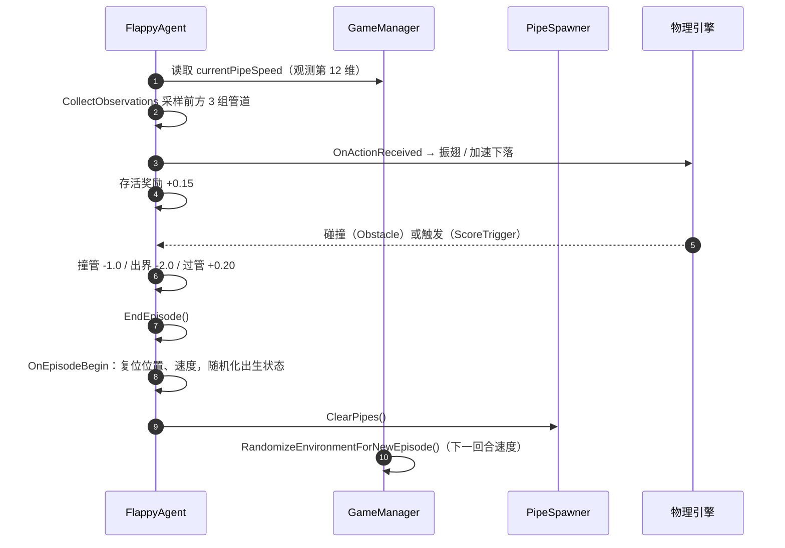

# 架构说明

本文描述工程的对象结构、脚本职责与一次决策的数据流。修改行为前请先读本文，避免只改一处导致观测/动作/奖励不自洽。

## 1. 场景与入口

| 场景 | 作用 | 关键对象 |
| --- | --- | --- |
| `Assets/Scenes/MainMenuScene.unity` | 入口。选择游戏模式、调节音量 | `MainMenuManager`、`SettingsManager`、`Canvas`、`EventSystem` |
| `Assets/Scenes/GameScene.unity` | 对局。手动游玩与 AI 推理都在这里 | `Bird`、`PipeSpawner`、`GameManager`、`BackgroundMusicManager` |

`ProjectSettings/EditorBuildSettings.asset` 中的场景顺序为 `MainMenuScene`(0) → `GameScene`(1)，构建产物会先进入菜单。

## 2. 脚本职责

| 脚本 | 职责 | 关键成员 |
| --- | --- | --- |
| `FlappyAgent.cs` | 智能体本体：观测、动作、奖励、回合边界 | `CollectObservations`、`OnActionReceived`、`HandleDeathOrEndEpisode` |
| `GameManager.cs` | 单例控制器：分数、UI、模式切换、每回合环境参数 | `currentPipeSpeed`、`ConfigureGameForMode`、`RandomizeEnvironmentForNewEpisode` |
| `PipeSpawner.cs` | 按随机间隔生成管道，随机高度与可见缝隙 | `minSpawnRate`/`maxSpawnRate`、`minVisibleGapSize`/`maxVisibleGapSize` |
| `PipeMovement.cs` | 管道左移与出屏销毁，速度取自 `GameManager` | `destroyXPosition` |
| `ScoreTrigger.cs` | 过管判定，通知 `GameManager` 计分 | `OnTriggerEnter` |
| `MainMenuManager.cs` | 菜单交互、模式常量、场景跳转 | `AImode`/`SimpleMode`/`HardMode`、`gameSceneName` |
| `SettingsManager.cs` | 跨场景保存模式与音量（`PlayerPrefs`） | `SelectedGameMode`、`MasterVolume` |
| `BackgroundMusicManager.cs` | 播放列表的四种播放模式与切歌 | `musicPlaylist`、`MusicPlaybackMode` |
| `BirdController.cs` | 早期手动控制示例，正式流程未挂载 | `jumpForce` |
| `SimpleHeuristicAgent.cs` | Heuristic 回调调试用示例 | `heuristicCallCount` |

> `BirdController` 与 `SimpleHeuristicAgent` 保留为调试参考，不参与正式对局；如需删除，请连同 `Assets/SimpleHeuristicAgent.cs` 与其 `.meta` 一起删除，并确认场景中没有对象引用其脚本 GUID。

## 3. 一次回合的生命周期

要点：

- `OnEpisodeBegin` 只负责"自己"和"管道清理"，环境速度由 `GameManager` 在 `IsGameActive()` 为真时随机（手动模式同样生效）。
- 死亡处理分两条路径：AI 模式走 `AddReward(penalty)` + `EndEpisode()`；手动模式（`HeuristicOnly`）只标记死亡并通知 `GameManager.HandlePlayerDeath()`，不结束回合。
- 死亡后 Rigidbody 被置为 `isKinematic = true` 并关闭重力，避免回合结束前继续下坠。

## 4. 观测的几何来源

`FlappyAgent.GetPipeInfo` 不依赖管道内部状态，而是从层级结构反推：

| 量 | 计算方式 |
| --- | --- |
| `DistanceX` | `pipePair.position.x - agent.position.x` |
| `RelativeGapCenterY` | `(顶层管道 localY + 底层管道 localY) / 2 + pipePair.y - agent.y` |
| `GapSize` | 优先取 `ScoreTrigger` 上 `BoxCollider.size.y`；缺失时用上下管道边缘 + `lossyScale` 估算并打警告 |

管道检索使用 `GameObject.FindGameObjectsWithTag("PipePair")`，按 X 距离排序后取最近的 3 组。**`PipePair` 预制体必须保留 `PipePair` 标签**，否则观测恒为默认值，训练无法收敛。

## 5. 模式与难度

模式索引定义在 `MainMenuManager`：

| 常量 | 值 | `BehaviorType` | 难度来源 |
| --- | --- | --- | --- |
| `AImode` | 0 | `InferenceOnly` | `aiDifficultySettings` 或 `difficultyLevels[aiUsesDifficultyLevelIndex]` |
| `SimpleMode` | 1 | `HeuristicOnly` | `difficultyLevels[0]` |
| `HardMode` | 2 | `HeuristicOnly` | `difficultyLevels[1]` |

- 选择 AI 模式时若 `BehaviorParameters.Model` 为空，`GameManager` 会报错并自动回退到简单模式，避免黑屏。
- 手动模式下空格 = 振翅、`LeftShift` = 加速下落；Esc 重载当前场景。
- 难度参数（速度、缝隙、生成频率）在 `GameManager.difficultyLevels` 与 `aiDifficultySettings` 中配置，运行时通过 `ApplyDifficultyParameters` 下发到 `PipeSpawner`。

## 6. 音频

`BackgroundMusicManager` 支持四种模式：停止、单曲循环、顺序播放、随机播放。播放列表挂在 `Assets/Prefabs/scenes/GameManager.prefab` 上，共 9 条引用，指向 `Assets/8Bit Music - 062022/` 下的 OGG 资源。

> 资源由 WAV 转为 OGG 后仍保留原 `.meta` 的 GUID，预制体引用通过 GUID 指向新文件，因此逻辑引用不变。首次导入后请在 Inspector 中确认播放列表没有空槽。

## 7. 已知取舍

| 取舍 | 影响 | 后续方向 |
| --- | --- | --- |
| 每步 `FindGameObjectsWithTag` | 每次决策产生临时分配，单场景 5 个环境时开销可接受 | `PipeSpawner` 维护注册表，观测直接读列表 |
| 观测不做手动归一化 | 依赖训练配置的 `normalize: true` | 对速度/距离做显式缩放，便于迁移到连续控制 |
| 缝隙通过改子对象 `localPosition` 实现 | 预制体需保持 `TopPipe` / `BottomPipe` 命名 | 改用脚本化参数 + 编辑器校验 |
| 单智能体、单场景 | 训练样本吞吐受限 | 多 Bird 实例（`TrainingAreaReplicator`）或 headless 多进程 |

## 8. 扩展点

| 想做的事 | 改动位置 |
| --- | --- |
| 新增动作（冲刺、滑翔） | `FlappyAgent.OnActionReceived` + `Behavior Parameters` 的 Branch Size + 观测维度自检常量 |
| 连续跳跃力度 | 动作空间改为 `Continuous`，`OnActionReceived` 读取 `ContinuousActions[0]` |
| 视觉输入 | 增加 `CameraSensorComponent`，`network_settings.vis_encode_type` 切到 `simple`/`nature_cnn` |
| 多智能体对抗 | 新增 `PipeAdversaryAgent`，共享 `Academy`，两侧奖励取反 |
| 课程学习 | 在训练配置中加入 `environment_parameters`，按课程调整缝隙/速度范围 |
